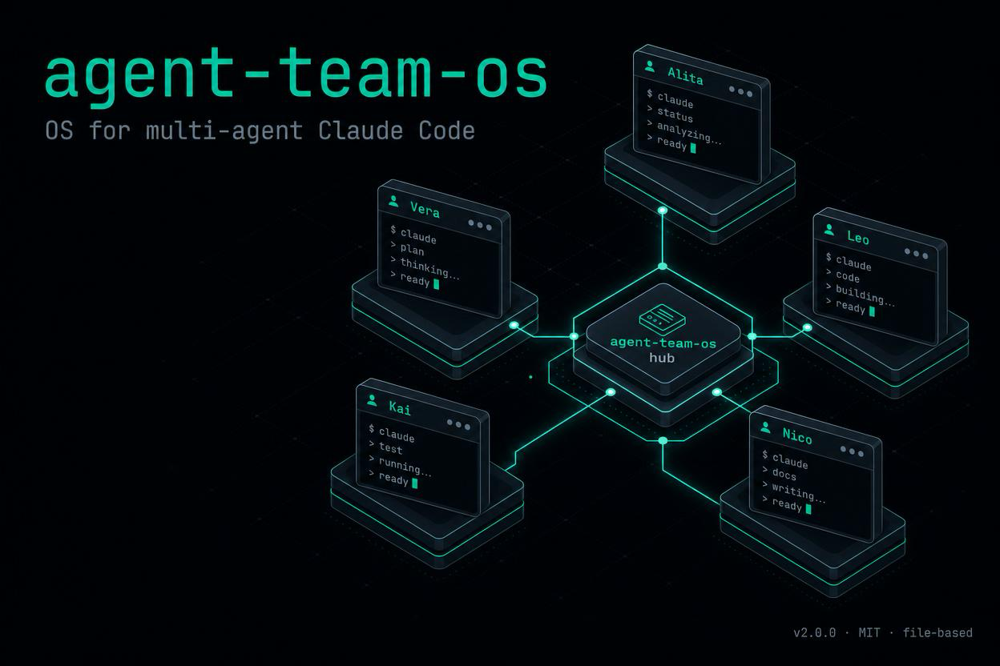

# Agent Team OS



> A local bus to coordinate multiple Claude Code instances across separate sessions: a small daemon, SQLite, six MCP tools.

[](https://opensource.org/licenses/MIT)
[](https://github.com/mariomosca/agent-team-os/releases/latest)
[](https://mariomosca.github.io/agent-team-os/)

**[Visit the landing page →](https://mariomosca.github.io/agent-team-os/)** for the full pitch, diagrams, FAQ and install instructions.

## Why

If you run more than one Claude Code session — one per project, one per role, one per repo — you quickly hit a wall: the sessions don't talk to each other. You become the human postman, copy-pasting context, briefs and handoffs between terminals.

Agent Team OS removes the postman.

Every machine runs a small daemon, the **centralino** (the switchboard). Each session sends structured messages to its peers through six MCP tools, finds its own inbox at session start, and is woken up when something it is waiting for comes back.

No server, no cloud. One daemon per machine, SQLite for state, a Unix socket on your own disk.

## What it gives you

- **Inbox per session**: each session sees what's waiting for it the moment you open it
- **Delegations**: declare `kind=delega` and the bus tracks the wait under a `task_id`; every return wakes you
- **Wake-ups**: an idle session gets a line in its prompt when a delegation, a question or an outcome arrives (Onda pane, or tmux on the Mac mini)
- **Threads**: replies stay grouped, so you can pick up a conversation a week later
- **Two machines**: one bus across a laptop and a Mac mini, over SSH
- **Slash commands**: `/inbox`, `/read`, `/send`, `/reply`, `/handoff`, `/delegate`, `/thread`, `/bus`
- **Live band above the prompt** (optional mod, Claude Code 2.1.287+) — pending messages for the session plus the **team** (which sibling sessions are stuck, from Onda): [`mods/bus-band`](./mods/bus-band)

## How it works

The centralino (`centralino/`, Python 3.12 with `uv`, stdlib only) is the only writer of the bus state, a SQLite database in `~/.agent-team-os/centralino.db`. It listens on a Unix socket (`0600`), decides who to wake and how, and talks to the other machine over SSH. Agents never touch files: they call MCP tools, and the hooks are thin clients of the same socket (with the daemon down they stay silent and never block).

The six tools come from the separate MCP server [`agent-bus-mcp`](https://github.com/mariomosca/agent-bus-mcp), which you configure in Claude Code:

| Tool | What it does |
|---|---|
| `bus_send` | new message; with `kind='delega'` it registers the wait and returns the `task_id` |
| `bus_reply` | answer a message (`response` or `question`); keeps thread and `task_id` |
| `bus_close` | consume a message (`chiuso`, `riarma`, `letto`), or close a delegation by `task_id` |
| `bus_inbox` | this session's pending messages and its open delegations |
| `bus_read` | one message in full, or a whole thread |
| `bus_status` | live sessions and hosts |

Each session finds its identity from its working directory via `~/.agent-team-os/AGENT_MAP.json`. The old tool names (`bus_gestisci`, `bus_archive`, `bus_waits`, `bus_expect`, `bus_thread`) stay as aliases until 31 October 2026.

### Architecture at a glance

```
  Claude Code sessions (one per folder)
  +-----------+  +-----------+  +-----------+
  | ops/api   |  | dev/app   |  | growth/.. |
  +-----+-----+  +-----+-----+  +-----+-----+
        |  MCP: 6 bus_* tools  +  hooks (thin clients)
        v              v              v
  +---------------------------------------------+
  |  centralino  (unix socket, only writer)     |
  |  SQLite: messages, waits, sessions, wakes   |
  +----+------------------------------+---------+
       | wake line                    | ssh <host> '<centralino> consegna'
       v                              v
  Onda pane (idle?)            +--------------------+
  tmux pane (Mac mini)         | centralino, mini   |
                               | own SQLite, tmux   |
                               +--------------------+
  laptop <---- mini's outbox/laptop, collected by the laptop
```

### Sessions: one agent, several workspaces

An agent name maps to a whole tree of projects, so the same agent often has several sessions open at once, one per folder. An address has two levels:

| Address | Goes to |
|---------|---------|
| `kai/noi-calendar` | that one session (the slug is the folder name, or `AB_SESSION_SLUG`) |
| `kai` | its only live session; with several, its home session; otherwise the shared box |
| `kai@mini/crewmoor` | a session on another machine |

Each session has its own inbox. Always answer with `bus_reply`: it puts the right session and machine in the address for you.

### Delegations

Every `request`, `brief` and `handoff` declares what it wants, and the bus refuses the send without it:

- `delega`: you want the outcome back. The wait is registered on your session, in the same transaction as the message, and the `task_id` travels with it.
- `comunicazione`: nothing comes back, nobody is woken.

The life of a delegation:

1. The delegator calls `bus_send(kind='delega')`. The executor is woken if idle.
2. If something is missing, the executor asks with `bus_reply(message_type='question')`. The question wakes the delegator and the delegation stays open. Until the answer arrives, the delegation does not hold the executor's Stop.
3. The delegator answers with `bus_reply`, which wakes the executor.
4. The executor sends the outcome with `bus_reply` on the delegation. It wakes the delegator.
5. The delegator consumes it with `bus_close`: `chiuso` closes the wait, `riarma` keeps waiting, `letto` just marks it read.

A message without a `task_id` is never taken for the return of a delegation. A wait expires at its `response_by`, or after 72 hours without activity, with a notice in the inbox. A delegation through an Onda pane (`onda_agent_prompt`) starts the prompt with `[delega]` or `[comunicazione]`; a hook registers the wait.

### La sveglia: when the bus wakes a session

A session counts as idle when Onda says so, with nothing typed in the box, for at least 5 seconds. A working session is never interrupted: messages queue up and arrive together at the end of the turn, in one wake. The channel is Onda (`agent.prompt` with `onlyIfIdle`) or tmux (on the Mac mini, which has no GUI login).

| Arrives | Wakes | Holds the Stop |
|---|---|---|
| outcome of your delegation | always | yes |
| question on your delegation | yes | yes |
| answer to you as executor | yes | yes |
| new delegation | yes | yes |
| `urgent` message | yes, at most once per 15 min per pair | yes |
| free question | no | yes |
| communication, event, notice | no | no |

Safety net: 10 wakes per hour per session, outcomes excluded. A session that is alive but has no wake channel reads `canale: nessuno` in `bus_status`. A session is alive if Onda reports it, or if it sent a heartbeat in the last 120 seconds.

### Stop hook (opt-in)

The installer copies a `Stop` hook but does not register it, because it changes behavior across every session. When enabled, it blocks the end of a turn while the inbox holds a message from the "Holds the Stop" column, at most 3 times in a row (then it lets you close). A message leaves the inbox only with an explicit outcome (`bus_close` or `bus_reply`). To turn it on, add to `~/.claude/settings.json`:

```json
{ "hooks": { "Stop": [{ "hooks": [{ "type": "command", "command": "~/.claude/hooks/agent-team-os-stop.sh" }] }] } }
```

Test it isolated first, see [`docs/agentic-v2/SETTINGS-DIFF.md`](./docs/agentic-v2/SETTINGS-DIFF.md).

## Install

Requires `jq` and `uv`.

```bash
git clone https://github.com/mariomosca/agent-team-os.git ~/agent-team-os
cd ~/agent-team-os
./install.sh --daemon --register-hooks
```

The installer is idempotent. It:

1. Copies the thin hooks to `~/.claude/hooks/` and the client script `agent-team-os-centralino.py` to `~/.claude/scripts/`
2. Copies the slash commands to `~/.claude/commands/` and the skill to `~/.claude/skills/agent-team-os/`
3. Creates `~/.agent-team-os/` and drops a starter `AGENT_MAP.json` (never overwritten)
4. Copies the `bus-band` mod to `~/.claude/mods/bus-band/` (loaded only once you opt in, see below)
5. With `--daemon`: starts the centralino (launchd when there is a GUI login, a cron line on a headless Mac)
6. With `--register-hooks`: adds SessionStart, UserPromptSubmit, SessionEnd and the PreToolUse hook on `onda_agent_prompt` to `settings.json` (backup first). The Stop hook stays opt-in.

`CLAUDE_HOME=<dir>` installs into another Claude Code config folder. The options of the old file bus (`--file-bus`, `--sveglia`, `--host-sync`) are rejected.

Then:

1. Edit `~/.agent-team-os/AGENT_MAP.json` to map your working directories to agent names.
2. Configure the MCP server [`agent-bus-mcp`](https://github.com/mariomosca/agent-bus-mcp) in Claude Code under the name `agent-bus`.

To stop the centralino use launchd or the pid in `centralino.pid`, never `pkill -f centralino` (it also kills other instances).

### Optional: the `bus-band` mod (Claude Code 2.1.287+)

A [mod](https://code.claude.com/docs/en/plugins/mods/overview) that keeps this session's pending messages in a band above the prompt and raises a toast when an urgent or high-priority one arrives. Read-only: it reads the centralino's view. Turn it on for every session:

```json
{ "env": { "CLAUDE_CODE_PLUGIN_DIRS": "~/.claude/mods/bus-band" } }
```

or for one session with `claude --plugin-dir <repo>/mods/bus-band`. Details: [`mods/bus-band/README.md`](./mods/bus-band/README.md).

## Two machines

One bus across two Macs, say a laptop you close and a Mac mini that stays on, when only one of them can open SSH to the other. Each machine runs its own centralino, with its own SQLite, from the same code.

**Addresses.** Add `@host`: `kai@mini` reaches the sessions of `kai` on the mini, `kai@mini/crewmoor` one session. Without `@host` a message goes to the agent's own host (`agents.<a>.host`), then to the hub host, then stays on this machine.

**Configuration.** On the hub, `AGENT_MAP.json` lists the hosts, with the command that runs the other machine's centralino:

```json
"hosts": {
  "laptop": { "hub": true },
  "mini":   { "ssh": "mini", "centralino": "<command that runs the mini's centralino>" }
}
```

Each remote machine's own name is in `~/.agent-team-os/HOST` (`./install.sh --host mini --daemon --register-hooks` on the mini; the hub needs none).

**Transport.**

| From → to | How |
|---|---|
| laptop → mini | `ssh <host> '<centralino> consegna'`, the mini's own centralino writes it |
| laptop → mini, mini down | kept in the laptop's `remote_queue`; the send says `queued=true`, it does not fail |
| mini → laptop | waits in the mini's `outbox/laptop/` until the laptop's centralino collects it |

Only the laptop ever opens SSH. `bus_status` lists the mini's live sessions with the age of the last known state.

### Il custode

The machine that stays on runs agents with nobody watching, so when it breaks nobody sees it: an expired Claude login, a bus MCP server that starts without tools. The custode is not an agent, it is a script (`scripts/agent-team-os-custode.sh`): every morning at 7:00 (launchd) it checks the host, writes a report and, if something is wrong, sends it on Telegram with the command that fixes it. It runs only on a remote host; on the hub it says so and exits 0.

| Check | What it looks at |
|---|---|
| `identita` | `HOST` set, `AGENT_MAP.json` valid, `hosts.<HOST>` present |
| `claude` | `claude -p` answers with the host's `CLAUDE_CONFIG_DIR`; **fail** on no answer or an expired login |
| `centralino` | the host's centralino answers `status` |
| `bus-mcp` | the `agent-bus` MCP server answers `initialize` + `tools/list` with its tools |
| `python` | the Python `uv` resolves in the server folder |
| `coda` | messages waiting in `outbox/<hub>/`: **warn** older than 1 h, **fail** older than 24 h (the laptop has not collected) |
| `repo` | git folders under `~/Projects` get `git pull --ff-only` if clean; dirty or diverged: **warn**, never touched |
| `disco` | **warn** under 20 GB free, **fail** under 5 |
| `launchd` | the `com.agent-team-os.*` jobs in `~/Library/LaunchAgents` are loaded |

Telegram: token and chat from `~/.config/portineria-mini/telegram.env` (`TELEGRAM_BOT_TOKEN`, `TELEGRAM_CHAT_ID`). All ok means silence, except one "tutto a posto" on Monday.

```bash
# install on the mini (needs --host, or HOST already set to a non-hub host)
CLAUDE_HOME=~/.config/claude-mini ./install.sh --host mini --custode
CLAUDE_HOME=~/.config/claude-mini ./install.sh --custode --uninstall   # remove it
# by hand (--no-telegram to just look, --json for the JSON)
~/.config/claude-mini/scripts/agent-team-os-custode.sh --no-telegram
```

Exit code `0` ok, `1` warn, `2` fail. The JSON report is `~/.agent-team-os/hosts/self/custode.json`, the log `~/.agent-team-os/logs/custode.log`.

## Example: define your agents

```json
{
  "version": "3.0",
  "rules": [
    { "pattern": "/Users/me/work",      "match": "prefix", "agent": "ops" },
    { "pattern": "/Users/me/projects",  "match": "prefix", "agent": "dev" },
    { "pattern": "/Users/me/marketing", "match": "prefix", "agent": "growth" }
  ],
  "fallback": "ops",
  "agents": {
    "ops":    { "role": "orchestrator", "capabilities": ["planning", "tracking"] },
    "dev":    { "role": "engineer",     "capabilities": ["bug-fix", "code-review", "refactor"] },
    "growth": { "role": "content",      "capabilities": ["draft-post", "review-copy"] }
  }
}
```

## Example: send a message

From your `ops` session, ask the model to delegate (or use the slash command):

```
/delegate dev bug-fix
```

The model previews the message (to, type, `kind`, priority, subject, deadline), and after your yes calls `bus_send(kind='delega')`. You get back a `task_id`.

The `dev` session is woken if idle, or sees at the next `SessionStart`:

```
=== Agent Team OS ===
You are dev. Inbox: 1 pending.
```

It reads the message with `bus_read`, works, and answers:

```
bus_reply(message_id=<the delegation>, message_type='response', summary='...')
```

The reply wakes `ops`, which consumes it with `bus_close(esito='chiuso')`, closing the wait.

## Message fields

```json
{
  "id": "msg-...",
  "from": "ops/api",
  "to": "dev/app",
  "type": "request | brief | handoff | event | response | question",
  "kind": "delega | comunicazione",
  "intent": "bug-fix | draft-post | code-review | ...",
  "priority": "urgent | high | normal | low",
  "thread_id": "thread-...",
  "in_reply_to": null,
  "task_id": "t-...",
  "response_by": "iso-8601",
  "payload": { "summary": "...", "details": "..." },
  "context_refs": [
    "file:///abs/path",
    "gh://owner/repo/issues/123",
    "graphiti://node/<uuid>",
    "wiki://<slug>"
  ]
}
```

`kind` is required for `request`, `brief` and `handoff`, absent on the rest. Constraints: payload under 10KB, no secrets, heavy content lives behind `context_refs`. The authoritative field list is in [`docs/PROTOCOL-v3.md`](./docs/PROTOCOL-v3.md) §4.

## Slash commands

They are shortcuts that tell the model which MCP tool to call.

| Command | What it does |
|---------|--------------|
| `/bus`     | Show roster and live sessions |
| `/inbox`   | List pending messages for this session and the delegations still waiting (`--all` for every session of the agent) |
| `/read <id>` | Read a message, resolve context_refs, consume it with an outcome |
| `/send <to> <intent>` | Compose a new message (`<to>` = `agent`, `agent/slug` or `agent@host/slug`) |
| `/reply <id> <type>`  | Reply inside the thread (`response` or `question`) |
| `/handoff <to>` | Hand off the current task to another agent |
| `/delegate <to> <intent>` | Delegate and wait for the outcome (`kind=delega`) |
| `/thread <id>`  | Show full thread history |

## Status

- **v3 (October 2026)**: the centralino with SQLite as the single source, one liveness rule, one wake table, six MCP tools. The file bus (`lib.sh`, `wake.py`, `collect.sh`), GOD mode, TaskProvider, harvest, the workspace filter, `routing_rules.deny` and the flat registry are gone; their history is in git (tag `br24-pre-rimozione`). See [`docs/PROTOCOL-v3.md`](./docs/PROTOCOL-v3.md) and [`docs/CENTRALINO.md`](./docs/CENTRALINO.md).
- **v2.8**: declared delegations (`kind`), automatic waits, a wake on every return, explicit consumption.
- **v2.1/v2.2**: the `bus-band` mod, with the team view.
- **v1.0 – v1.4**: the original file-based protocol, battle-tested across five concurrent agents since May 2026, and session addressing (`agent/slug`).
- **MCP server**: [`agent-bus-mcp`](https://github.com/mariomosca/agent-bus-mcp).
- Older ideas (conductor pattern, autonomous mode with guard-rails): [ROADMAP.md](./ROADMAP.md).

## Why not just use one Claude Code instance?

Because context is finite. One instance per role — engineering, marketing, ops — keeps each session focused, lets each one carry its own conventions, skills and memory, and stops them from stepping on each other's toes. The cost is coordination. Agent Team OS is the cheapest possible coordination layer.

## Contributing

PRs welcome. The protocol is documented in [`docs/PROTOCOL-v3.md`](./docs/PROTOCOL-v3.md); the daemon has its own tests in `centralino/tests/` and a simulation bench (`centralino sim`). Breaking changes bump the major.

## License

[MIT](./LICENSE) — use it, fork it, adapt it. Attribution appreciated, not required.

---

Built by [Mario Mosca](https://github.com/mariomosca) — IT Senior Manager & indie builder. Originally extracted from a personal multi-agent setup running five Claude Code sessions in parallel.
