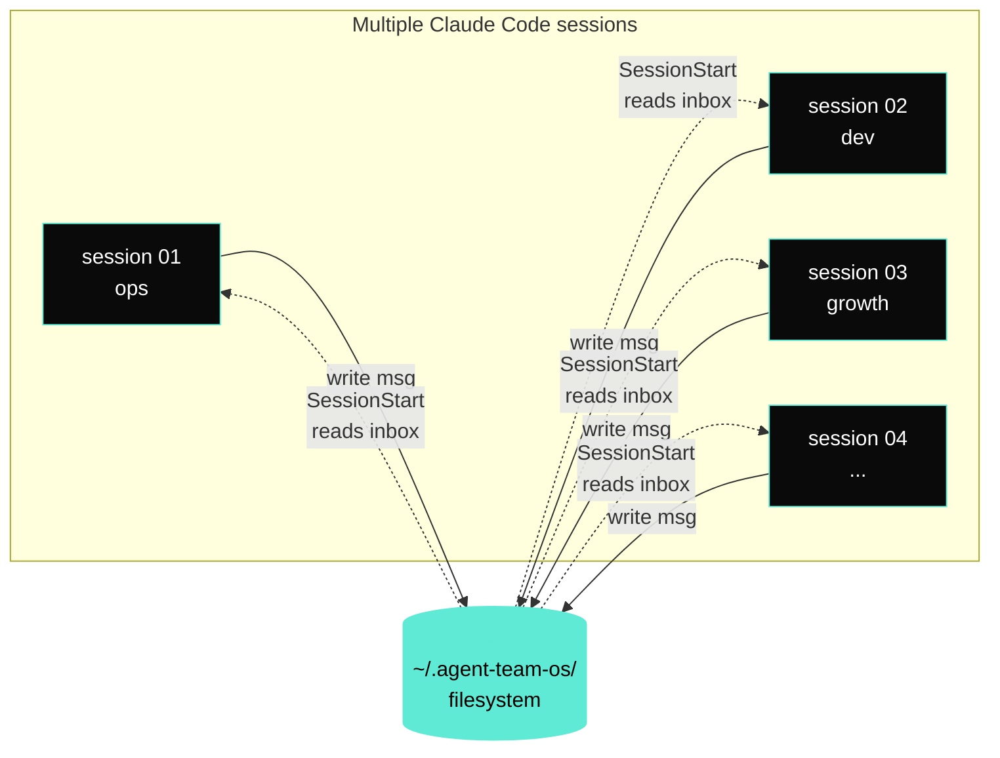
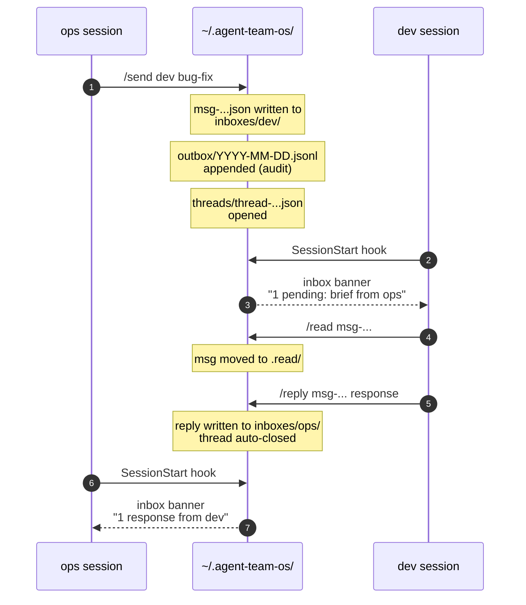
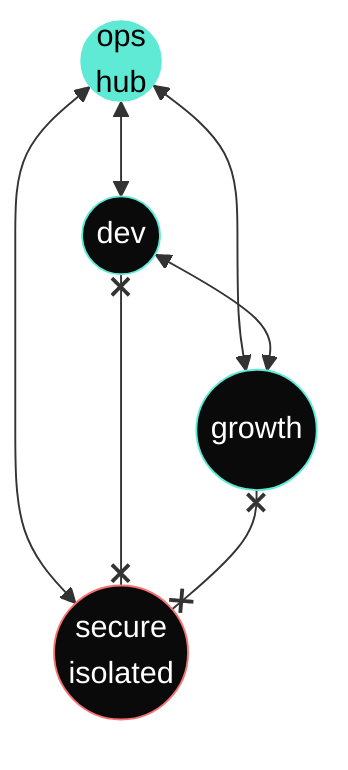

# Agent Team OS


> A minimal file-based protocol to coordinate multiple Claude Code instances across separate sessions.

[](https://opensource.org/licenses/MIT)
[](https://github.com/mariomosca/agent-team-os/releases/latest)
[](https://mariomosca.github.io/agent-team-os/)

**[Visit the landing page →](https://mariomosca.github.io/agent-team-os/)** for the full pitch, diagrams, FAQ and install instructions.

## Why

If you run more than one Claude Code session — one per project, one per role, one per repo — you quickly hit a wall: the sessions don't talk to each other. You become the human postman, copy-pasting context, briefs and handoffs between terminals.

Agent Team OS removes the postman.

It's a tiny convention — a folder structure, a JSON message schema, a handful of bash helpers and slash commands — that lets each Claude Code instance read its own inbox at session start, send structured messages to its peers, and resume threaded conversations days later.

No daemon. No server. No cloud. Just files on your machine.

## What it gives you

- **Inbox per agent** — each session sees what's waiting for it the moment you open it
- **Structured messages** — versioned JSON with `from`, `to`, `intent`, `payload`, `context_refs`, deadlines
- **Threads** — replies stay grouped, so you can pick up a conversation a week later
- **Routing rules** — declare which agents can talk to which (e.g. isolate work contexts from personal ones)
- **Audit log** — append-only JSONL of every message sent, for free
- **Slash commands** — `/inbox`, `/read`, `/send`, `/reply`, `/handoff`, `/thread`, `/bus`
- **Live band above the prompt** (optional mod, Claude Code 2.1.287+) — pending messages for the session plus the **team** (which sibling sessions are stuck, from Onda), toast on urgent ones: [`mods/bus-band`](./mods/bus-band)

## How it works

```
~/.agent-team-os/
  AGENT_MAP.json                  # path -> agent + capabilities + routing rules
  registry/<agent>.d/<slug>.json  # one card per LIVE SESSION (active, last_seen, workspace)
  registry/<agent>.json           # flat card, kept for older readers
  inboxes/<agent>/                # broadcast msg-*.json — every session of that agent
  inboxes/<agent>/@<slug>/        # messages for ONE session
  inboxes/<agent>/@<slug>/.read/  # archive, next to the message it came from
  threads/<thread-id>.jsonl       # conversation history
  outbox/<agent>.jsonl            # append-only audit log
  locks/                          # mkdir-based atomic locks
```

Each Claude Code session detects its identity from its current working directory via `AGENT_MAP.json`. A `SessionStart` hook registers the session and prints any pending inbox messages. Slash commands handle the rest.

### Sessions: one agent, several workspaces (v1.4)

An agent name maps to a whole tree of projects, so the same agent often has **several sessions open at once** — e.g. two `kai`, one per project. Addressing them by name alone makes them share a queue: whichever reads first wins, and the other never sees the message.

So an address has two levels:

| Address | Goes to |
|---------|---------|
| `kai` | every live session — use for announcements |
| `kai/noi-calendar` | that one session |

The message JSON keeps the bare agent in `to`; the session lives in the path. Sending to a name that has one session behaves exactly as before, so nothing existing has to change.

Each session gets its own inbox, its own registry entry and its own drain cursor, so the Stop hook can no longer hold one session hostage to another's unread mail. `/bus` lists the live sessions and their pending counts; `/inbox` shows this session's messages and `--all` shows the others'.

### Architecture at a glance



No daemon listens. Every session writes to and polls the filesystem independently. The hook only fires on session boundaries — there's nothing running between turns.

### Message lifecycle



A request → response cycle never has both sessions live at the same time. Filesystem is the rendezvous.

### Routing rules



Declare blocked pairs in `AGENT_MAP.json` to keep contexts isolated. Cross-impact between walled agents must route through the hub.

## Install

### Option A — As a Claude Code plugin (recommended)

In any Claude Code session:

```
/plugin marketplace add mariomosca/claude-plugins
/plugin install agent-team-os@mariomosca-claude-plugins
```

The plugin registers its hooks, skill and slash commands automatically. On first run it drops a starter `AGENT_MAP.json` in `~/.agent-team-os/` for you to edit.

### Option B — Manual install

If you'd rather not use the plugin marketplace, the bundled installer does the same job:

```bash
git clone https://github.com/mariomosca/agent-team-os.git ~/agent-team-os
cd ~/agent-team-os
./install.sh
```

The installer:

1. Copies the helper library to `~/.claude/scripts/agent-team-os-lib.sh`
2. Copies the `SessionStart` hook to `~/.claude/hooks/agent-team-os-load.sh`
3. Copies the slash commands to `~/.claude/commands/`
4. Copies the auto-attaching skill to `~/.claude/skills/agent-team-os/`
5. Creates `~/.agent-team-os/` runtime folders
6. Drops a starter `AGENT_MAP.json` you can edit
7. Copies the `bus-band` mod to `~/.claude/mods/bus-band/` (loaded only once you opt in, see below)

Options: `--register-hooks` adds the two hooks to `settings.json` for you; `--host` / `--host-sync` are for [two machines](#two-machines). `CLAUDE_HOME=<dir>` installs into another Claude Code config folder.

In both cases, edit `~/.agent-team-os/AGENT_MAP.json` to map your working directories to agent names.

### Optional: drain-on-Stop hook (v2)

The installer also copies a `Stop` hook (`agent-team-os-stop.sh`) but **does not register it** — it's opt-in because it changes behavior across every session. When enabled, it blocks a session from closing while its inbox still has unhandled messages (with a loop guard so you're never trapped). To turn it on, add to `~/.claude/settings.json`:

```json
{ "hooks": { "Stop": [{ "hooks": [{ "type": "command", "command": "~/.claude/hooks/agent-team-os-stop.sh" }] }] } }
```

Test it isolated first — see [`docs/agentic-v2/SETTINGS-DIFF.md`](./docs/agentic-v2/SETTINGS-DIFF.md). For the full v2 layers (dual-GOD orchestration, TaskProvider, telemetry) see [`AGENTS.md`](./AGENTS.md).

### Optional: the `bus-band` mod (Claude Code 2.1.287+)

A [mod](https://code.claude.com/docs/en/plugins/mods/overview) that keeps this session's pending messages in a band above the prompt and raises a toast when an urgent or high-priority one arrives. Read-only, no network. Turn it on for every session:

```json
{ "env": { "CLAUDE_CODE_PLUGIN_DIRS": "~/.claude/mods/bus-band" } }
```

or for one session with `claude --plugin-dir <repo>/mods/bus-band`. Details: [`mods/bus-band/README.md`](./mods/bus-band/README.md).

## Two machines

One bus across two Macs — say a laptop you close and a Mac mini that stays on — when only one of them can open SSH to the other. Same user, same paths, same `AGENT_MAP.json` on both. No server, no new daemon besides one launchd job on the laptop: the bus is still files.

**Addresses.** Add `@host`: `kai@mini` reaches every session of `kai` on the mini, `kai@mini/crewmoor` one session. Without `@host` a message goes to the agent's own host (`agents.<a>.host`; the hub agent, `cc_awareness.hub`, lives on the host marked `hub`) or stays on the machine you are on. A host not in `hosts` is a clear error.

```json
"hosts": {
  "laptop": { "hub": true },
  "mini":   { "ssh": "mini", "bus_home": "/Users/me/.agent-team-os" }
}
```

Each machine's own name is in `~/.agent-team-os/HOST` (`install.sh --host mini`); the hub needs none. Keeping it out of the map lets the map stay byte-identical on both machines.

**Transport.** Only the machine that has an `ssh` target for the other one ever connects:

| From → to | How |
|---|---|
| laptop → mini | SSH, atomic write (`tmp` + `mv`) into the mini's inbox |
| laptop → mini, mini down | kept in the laptop's `outbox/mini/`, pushed at the next collection; the send says `queued`, it does not fail |
| mini → laptop | written to the mini's `outbox/laptop/`; the laptop pulls it |
| same machine | local, as before |

`outbox/<host>/` always means *not yet delivered to `<host>`* and mirrors the inbox layout (`<agent>/[@slug/]msg-*.json`), so the session travels in the path. Messages carry the sender's machine in `context.host` (additive, schema in [`schema/bus-message.schema.json`](./schema/bus-message.schema.json)), so `/reply` and the MCP `reply_to` answer `kai@mini/crewmoor` instead of a local `kai`. Thread ids travel with the message.

**Collection.** On the laptop, `/inbox`, `/bus`, the MCP `bus_inbox`/`bus_status` and the `UserPromptSubmit` hook collect when the last round is older than 30 s (the hooks in the background, so a prompt never waits on SSH). One round = push what is queued for the mini, then pull the mini's `outbox/laptop/` in one `tar` over SSH: copy into the local inbox, verify, and only then delete on the mini. A message already delivered (or already archived) is not delivered twice; an unreadable one stays on the mini. A launchd job (`com.agent-team-os.raccolta-mini`, every 60 s, from `install.sh --host-sync`) covers sessions that never touch the bus. SSH runs with `BatchMode=yes`, `ConnectTimeout=5` and a 10-minute `ControlMaster`, so a round costs milliseconds while the mini is up and at most 5 s when it is not.

**Status.** `/bus` and `bus_status` list the mini's live sessions (its registry read over SSH, cached 20 s, last known list kept while it is down), with their `agent@host/slug` address, what is queued for it and the last collection.

**Install.**

```bash
# on the mini (Claude Code config in ~/.config/claude-mini)
CLAUDE_HOME=~/.config/claude-mini ./install.sh --host mini --register-hooks
# on the laptop
./install.sh --host-sync
```

Routing rules and cc-awareness are unchanged: the host changes the transport, not who may talk to whom.

### Il custode

The machine that stays on runs agents with nobody watching, so when it breaks nobody sees it: an expired Claude login, a bus MCP server that starts without tools. The custode is not an agent, it is a script: every morning at 7:00 (launchd) it checks the host, writes a report and, if something is wrong, sends it on Telegram with the command that fixes it.

| Check | ok / warn / fail |
|---|---|
| `claude` | `claude -p "Rispondi solo: OK" --model haiku` with the host's `CLAUDE_CONFIG_DIR`, 120 s. **fail** on no answer or "login"/"expired" in the output |
| `bus-mcp` | the `agent-bus` server (command read from `$CLAUDE_CONFIG_DIR/.claude.json`, as Claude Code starts it) answers `initialize` + `tools/list` with its 6 tools. **fail** with the last stderr line or the missing tools |
| `python` | the Python `uv` resolves in the server folder: **fail** if >= 3.15, **warn** if `.python-version` is missing |
| `coda` | messages waiting in `outbox/<hub>/`: **warn** older than 1 h, **fail** older than 24 h (the laptop has not collected) |
| `identita` | `HOST` set, `AGENT_MAP.json` valid, `hosts.<HOST>` present |
| `repo` | every git folder under `~/Projects` (depth 1-2) on a branch with an upstream and no tracked changes: `git pull --ff-only`. Dirty or diverged: **warn**, not touched. Never `reset`, never `stash` |
| `disco` | **warn** under 20 GB free, **fail** under 5 |
| `launchd` | every `com.portineria.*` / `com.agent-team-os.*` plist in `~/Library/LaunchAgents` is loaded, else **warn** |

Telegram: token and chat from `~/.config/portineria-mini/telegram.env` (`TELEGRAM_BOT_TOKEN`, `TELEGRAM_CHAT_ID`), the token goes to `curl` on stdin. All ok means silence, except one "tutto a posto" on Monday. No Telegram file: said in the report, the exit code still follows the checks.

```bash
# install on the mini (needs --host, or HOST already set to a non-hub host)
CLAUDE_HOME=~/.config/claude-mini ./install.sh --host mini --custode
CLAUDE_HOME=~/.config/claude-mini ./install.sh --custode --uninstall   # remove it
# by hand (--no-telegram to just look, --json for the JSON)
~/.config/claude-mini/scripts/agent-team-os-custode.sh --no-telegram
jq '.status, (.checks[] | select(.status != "ok"))' ~/.agent-team-os/hosts/self/custode.json
```

Exit code `0` ok, `1` warn, `2` fail. `hosts/self/custode.json` is `{at, host, status, checks: [{name, status, detail, fix}], notify: {sent, note}}`, fails first, written atomically. Log in `~/.agent-team-os/logs/custode.log`. On the hub (no `HOST`, or `HOST` = the hub) it says so and exits 0.

## Example: define your agents

```json
{
  "version": "1.2",
  "rules": [
    { "pattern": "/Users/me/work",      "match": "prefix", "agent": "ops" },
    { "pattern": "/Users/me/projects",  "match": "prefix", "agent": "dev" },
    { "pattern": "/Users/me/marketing", "match": "prefix", "agent": "growth" }
  ],
  "fallback": "ops",
  "agents": {
    "ops":    { "role": "orchestrator", "capabilities": ["planning", "tracking"] },
    "dev":    { "role": "engineer",     "capabilities": ["bug-fix", "code-review", "refactor"] },
    "growth": { "role": "content",      "capabilities": ["draft-post", "review-copy"] }
  },
  "routing": {
    "blocked_pairs": []
  }
}
```

## Example: send a message

From your `ops` session:

```
/send dev bug-fix
```

The wizard collects payload, deadline, context references and writes a JSON message to `~/.agent-team-os/inboxes/dev/`.

Next time you open a Claude Code session in `/Users/me/projects/...`, the `SessionStart` hook prints:

```
=== Agent Team OS ===
You are dev. Inbox: 1 pending.
  - msg-20260520T091812Z-x7q3  [normal] brief/bug-fix from ops  (by 2026-05-23T18:00:00+02:00)
```

Then:

```
/read msg-20260520T091812Z-x7q3
```

…shows the full payload, resolves `context_refs` (file paths, GitHub issues, knowledge graph nodes), and moves the message to `.read/`.

When done:

```
/reply msg-20260520T091812Z-x7q3 response
```

…closes the thread and notifies the sender.

## Message schema (v1.0)

```json
{
  "id": "msg-<iso-compact>-<rand8>",
  "version": "1.0",
  "from": "ops",
  "to": "dev",
  "thread_id": "thread-YYYYMMDD-<rand>",
  "in_reply_to": null,
  "type": "request | response | brief | handoff | question | review-request | event | confirm | decline",
  "intent": "bug-fix | draft-post | code-review | ...",
  "priority": "urgent | high | normal | low",
  "payload": { },
  "context_refs": [
    "file:///abs/path",
    "gh://owner/repo/issues/123",
    "graphiti://node/<uuid>",
    "wiki://<slug>"
  ],
  "requires_response": true,
  "response_by": "iso-8601",
  "ts": "iso-8601"
}
```

Constraints: payload under 10KB, no secrets, ISO-8601 timestamps with timezone, heavy content lives behind `context_refs`.

## Routing rules

You can declare blocked pairs in `AGENT_MAP.json` to keep contexts isolated — for example, prevent a personal content agent from messaging a work-only engineering agent. The `ab_write_message` helper refuses messages that violate the rules (exit code 2).

## Slash commands

| Command | What it does |
|---------|--------------|
| `/bus`     | Show roster, live sessions with pending counts, and routing rules |
| `/inbox`   | List pending messages for this session (`--all` for every session of the agent) |
| `/read <id>` | Read a message, resolve context_refs, archive it |
| `/send <to> <intent>` | Wizard to compose a new message (`<to>` = `agent` or `agent/slug`) |
| `/reply <id> <type>`  | Reply to a message inside its thread |
| `/handoff <to>` | Hand off the current task to another agent |
| `/thread <id>`  | Show full thread history |

## Status

- **v1.0**: file-based protocol, bash helpers, slash commands, `SessionStart` hook — battle-tested across five concurrent agents in production since May 2026.
- **v1.4**: session identity — `agent/slug` addressing, per-session inbox, registry and drain cursor. Written after two sessions of the same agent were found stealing each other's messages.
- **v2.2**: `bus-band` shows the team — who is stuck (text left in the prompt box, waiting for a permission) and a button to put an out-of-mosaic workspace back in Onda.
- **v2.1**: `bus-band` mod — the inbox as a live band above the prompt, built on Claude Code mods the day after they shipped.
- **MCP server**: [`agent-bus-mcp`](https://github.com/mariomosca/agent-bus-mcp) exposes the bus as six typed tools (`bus_status`, `bus_inbox`, `bus_read`, `bus_send`, `bus_archive`, `bus_thread`), session addressing included. Optional: the slash commands keep working on the same files.
- **v1.1+**: realtime delivery, conductor pattern, active driver, autonomous mode with guard-rails — see [ROADMAP.md](./ROADMAP.md).

## Why not just use one Claude Code instance?

Because context is finite. One instance per role — engineering, marketing, ops — keeps each session focused, lets each one carry its own conventions, skills and memory, and stops them from stepping on each other's toes. The cost is coordination. Agent Team OS is the cheapest possible coordination layer.

## Contributing

PRs welcome. The schema is versioned (`version: "1.0"`) so backwards-compatible additions are easy. Breaking changes bump the major.

## License

[MIT](./LICENSE) — use it, fork it, adapt it. Attribution appreciated, not required.

---

Built by [Mario Mosca](https://github.com/mariomosca) — AI Transformation Manager & indie builder. Originally extracted from a personal multi-agent setup running five Claude Code sessions in parallel.
